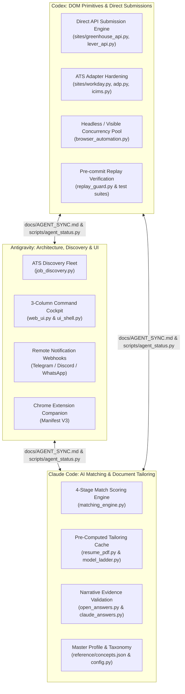

# Unified Multi-Agent Transformation Plan: Elevating to Autonomous Parity with Tsenta

> **Coordinated Agents:** Antigravity (Architecture & UI), Claude Code (AI & Matching Engine), Codex (DOM Primitives & API Submissions)  
> **Source of Truth:** [`docs/AGENT_SYNC.md`](AGENT_SYNC.md)  
> **Status Check Command:** `python scripts/agent_status.py`  
> **Target Benchmark:** Tsenta (YC S26) Autonomous Job Agent  
> **Date:** October 2026

---

## 1. Executive Vision & Core Objective

Transform the current **reactive, manual-input desktop assistant** into an **autonomous, proactive job-application agent** that:
1. **Discovers jobs within minutes of publication** by continuously monitoring major ATS endpoints (Greenhouse, Lever, Ashby, Workday CXS) rather than waiting for manual URL pasting.
2. **Scores and prioritizes candidate fit** (0–100% Match) using a 4-stage pipeline (Hard constraints $\rightarrow$ Lexical ATS tokens $\rightarrow$ Dense semantic embeddings $\rightarrow$ LLM fit analysis).
3. **Executes submissions in seconds** via a **Dual Submission Engine** (Direct multipart HTTP POST for Greenhouse/Lever; Playwright for complex Workday/ADP/iCIMS multi-step flows).
4. **Provides an Omnichannel Experience** via a modern 3-column Command Cockpit (`web_ui.py`), remote 1-tap messaging alerts (Telegram/Discord/WhatsApp), and a 1-click Chrome Extension companion.
5. **Maintains 100% Truthfulness and Safety**: Preserves `SubmissionGuardV0`, exact readback verifications (`f206`), anti-hallucination evidence checking (`f208`–`f211`), and owner approval boundaries.

---

## 2. Multi-Agent Division of Labor

To prevent overlapping edits, branch divergence, or duplicated effort, responsibilities are cleanly divided across the 9 subsystems:



| Agent | Primary Subsystems | Concrete Responsibilities |
| :--- | :--- | :--- |
| **Antigravity** | **Subsystems 1, 8, 9** (Orchestration, Discovery, UI & Alerts) | • Implement `job_discovery.py` (continuous polling of ATS APIs).<br>• Overhaul `web_ui.py` into a modern 3-column Command Cockpit.<br>• Build remote approval webhooks (`notifications.py`).<br>• Author Chrome Extension companion. |
| **Claude Code** | **Subsystems 3, 7** (Knowledge, AI Models, Match Scoring & Tailoring) | • Implement 4-stage match scoring pipeline (`matching_engine.py`).<br>• Build pre-computed resume tailoring cache (instant zero-delay runtime).<br>• Enforce semantic and factual evidence review (`open_answers.py`).<br>• Expand concept taxonomy in `reference/concepts.json`. |
| **Codex** | **Subsystems 2, 4, 5, 6** (DOM Primitives, Direct Submissions, Safety & Adapters) | • Implement direct multipart API submitters (`sites/greenhouse_api.py`, `sites/lever_api.py`).<br>• Harden complex multi-step ATS adapters (`sites/workday.py`, `sites/adp.py`, `sites/icims.py`).<br>• Manage headless worker pools with visible desktop handoff.<br>• Run 600+ page regression verification with `replay_guard.py`. |

---

## 3. Four-Phase Technical Roadmap

### Phase 1: Proactive Discovery & Fit Match Scoring
*Goal: Stop relying on manual copy-pasting. Automatically discover roles within minutes of posting and rank them by match percentage.*

- **Tasks for Antigravity**:
  1. Create `job_discovery.py`: Lightweight worker monitoring configured companies across Greenhouse, Lever, Ashby, and Workday CXS.
  2. Implement queue schema in `data/job_queue.db` (`discovered_jobs` table).
  3. Add the **"Discovered Opportunities Feed"** tab to `web_ui.py`.
- **Tasks for Claude Code**:
  1. Create `matching_engine.py`:
     - Stage 1: Hard filter gate (Visa sponsorship, Remote/Hybrid/Onsite, Seniority).
     - Stage 2: Lexical keyword extraction with weighted ATS tokens (3.0 for requirements, 1.0 for nice-to-have).
     - Stage 3: Fast local dense semantic embeddings for cosine similarity.
  2. Output structured fit analysis (match %, matching skills, missing skills, recommendation).
- **Validation Criteria**:
  - `pytest tests/test_job_discovery.py` & `pytest tests/test_matching_engine.py` pass.
  - Feeding 20 sample job descriptions outputs accurate match scores and correct eligibility rejections.

---

### Phase 2: Direct API Submissions (Fast-Path) & Pre-Tailoring Cache
*Goal: Cut application time from 3 minutes to under 5 seconds for supported platforms, and eliminate AI tailoring wait times during runs.*

- **Tasks for Codex**:
  1. Implement `sites/greenhouse_api.py` and `sites/lever_api.py`:
     - Send authenticated/signed multipart `POST` requests directly to employer submit endpoints.
     - Automatically attaches binary PDF bytes and standard profile answers.
     - Fallback: If Cloudflare Turnstile or unknown custom questions are encountered, automatically divert to the Playwright browser runner.
  2. Headless Concurrency Worker Pool:
     - Run headless Playwright workers for multi-page forms (Workday).
     - Auto-escalate to visible desktop (`visible_desktop.py`) only when user review or CAPTCHA handoff is needed.
- **Tasks for Claude Code**:
  1. Implement Pre-Computed Document Cache (`document_cache.py`):
     - When a job is accepted into the queue, asynchronously tailor the resume and cover letter ahead of time.
     - When the apply runner starts, the tailored PDF is already compiled and cached on disk—zero seconds spent waiting on LLM generation.
- **Validation Criteria**:
  - Synthetic test submitting to Greenhouse endpoint completes in $< 5$ seconds.
  - Zero hallucinations or corrupted PDFs verified against existing claim checkers (`f208`).

---

### Phase 3: Modern Command Cockpit UI & Remote Webhook Alerts
*Goal: Provide a unified 3-column desktop cockpit and enable remote 1-tap mobile approvals.*

- **Tasks for Antigravity**:
  1. **Overhaul `web_ui.py` into a 3-Column Command Cockpit**:
     - **Column 1 (Left): Discovered Feed & Queue**: Filter by match percentage, remote status, or ATS. Quick buttons: `Auto-Apply`, `Review`, `Dismiss`.
     - **Column 2 (Center): Active Application Cockpit**: Live DOM snapshot or canvas screenshot stream of the active run. Interactive review cards for inline questions without switching windows.
     - **Column 3 (Right): Application Tracker & Receipts**: Searchable history, live status badges (`Submitted`, `Interviewing`, `Needs Review`), and one-click PDF/Answer receipts.
  2. **Remote Webhooks (`notifications.py`)**:
     - Telegram / Discord / WhatsApp webhook integration.
     - High-match alert format:
       > 🎯 **Senior Cloud Network Engineer @ Datadog**  
       > **Match:** 94% | **Location:** Remote | **Salary:** \$165k–\$185k  
       > [Apply Now (Auto)] | [Review in Cockpit] | [Dismiss]
     - Replying `/apply <id>` immediately triggers the background worker.
- **Validation Criteria**:
  - Dashboard loads responsively in $< 500\text{ms}$.
  - Webhook delivery verified with synthetic test message.

---

### Phase 4: Chrome Extension Companion
*Goal: Bridge manual browsing on LinkedIn/Indeed with your local automated agent.*

- **Tasks for Antigravity & Codex**:
  1. Author Manifest V3 Chrome Extension (`extension/`):
     - Automatically detects when you are viewing a job posting on LinkedIn, Indeed, Greenhouse, or Workday.
     - Calls local agent endpoint (`GET http://127.0.0.1:5000/api/match?url=...`).
     - Injects a sleek floating badge on the page:  
       `⚡ 92% Match with your Profile — [1-Click Apply with Agent]`.
     - Clicking sends the URL to the local queue and starts the runner.
- **Validation Criteria**:
  - Extension successfully injects on target URLs and communicates with local Flask loopback API.

---

## 4. Multi-Agent Operational Protocol & Invariants

To guarantee that Antigravity, Claude Code, and Codex never conflict, all three agents MUST follow these mandatory rules:

1. **Pre-Flight Check (Mandatory First Action)**:
   - Run `python scripts/agent_status.py` and read [`docs/AGENT_SYNC.md`](AGENT_SYNC.md).
   - Check the uncommitted working-tree files, pending branches, latest failure catalogue ID (`fNNN`), and active backlog items.
   - **Never revert or overwrite another agent's in-flight work.**
2. **Failure Catalogue Reservation Protocol**:
   - Check the highest `fNNN` ID in `reference/failures/`.
   - Never reuse an existing ID. The latest ID is currently **`f215`**; the next available ID is **`f216`**.
3. **Safety & Guard Rails**:
   - **Zero edits to `safety.py` without explicit owner approval.**
   - All final submit actions must pass through `SubmissionGuardV0` or authorized human handoff.
   - Preserve human-paced typing cadences (`f206`) and exact readback verification on browser fills.
   - Preserve provenance order: Structured Profile $\rightarrow$ Approved Saved Answers $\rightarrow$ Deterministic Rules $\rightarrow$ AI Reasoning $\rightarrow$ User Intervention. Never fabricate credentials.
4. **Post-Task Completion Protocol**:
   - Update [`docs/AGENT_SYNC.md`](AGENT_SYNC.md) Section 3 and Section 4.
   - Update [`BEHAVIOUR.md`](../BEHAVIOUR.md) for any runtime behavioral changes.
   - Re-run `python scripts/agent_status.py` to confirm a clean state before ending the session.

---

## 5. Granular Technical Blueprints for Claude Code & Codex

### 5.1 Claude Code: Intelligence, Match Scoring & Document Cache

#### A. 4-Stage Match Scoring Engine (`matching_engine.py` — Backlog `P3-2`)
* **Module**: `matching_engine.py`
* **Purpose**: Evaluate any discovered requisition or user-supplied job description against candidate profile and master resume with high precision ($0–100\%$).
* **Data Model**:
  ```python
  from dataclasses import dataclass
  from typing import Optional, List, Dict, Any

  @dataclass
  class MatchResult:
      overall_score: int                   # 0 to 100
      is_eligible: bool                    # False if hard gate fails
      disqualification_reason: Optional[str] # e.g., "Requires US Citizenship" or "No Visa Sponsorship"
      matched_skills: List[str]            # e.g., ["BGP", "Kubernetes", "Terraform", "Python"]
      missing_skills: List[str]            # e.g., ["Golang", "GCP"]
      stage_breakdown: Dict[str, Any]      # Sub-scores: {"gate": 100, "lexical": 85, "semantic": 90, "llm": 92}
      summary: str                         # 2-3 sentence technical fit justification
  ```
* **Execution Pipeline**:
  1. `check_hard_gates(jd_text: str, profile: dict) -> tuple[bool, Optional[str]]`:
     - Disqualify if candidate requires visa sponsorship and JD matches:
       `r"\b(no sponsorship|unable to sponsor|not provide sponsorship|must be a us citizen|requires us citizenship|security clearance (?:required|secret|top secret))\b"`.
     - Disqualify if candidate is restricted to Dallas/Austin/Ashburn or Remote, and JD specifies strict non-remote onsite elsewhere (e.g. London, Seattle, NYC).
  2. `score_lexical(jd_text: str, resume_text: str, skills: list[str]) -> tuple[float, list[str], list[str]]`:
     - Token overlap: Skills in "Requirements" section receive $3\times$ weight; skills in "Preferred" receive $1\times$.
  3. `score_semantic(jd_text: str, resume_text: str) -> float`:
     - Cosine similarity between job requirements summary and candidate experience using local or lightweight embeddings.
  4. `synthesize_fit(jd_text: str, profile: dict, sub_scores: dict) -> MatchResult`:
     - Invokes configured model ladder (`model_ladder.py` / Claude 3.5 Sonnet / Gemini Flash) to return structured JSON `MatchResult`.
* **Testing**: `tests/test_matching_engine.py` with mock JDs asserting hard-gate rejections and high-fit network roles.

#### B. Pre-Computed Document Cache (`document_cache.py` — Phase 2)
* **Module**: `document_cache.py`
* **Purpose**: Eliminate live runtime wait times (30–60s) spent generating and compiling tailored PDFs while the browser is stalled on the application page.
* **Methods**:
  - `precompute_documents(job_id_or_url: str, jd_text: str, company: str, title: str) -> Path`:
    - Tailors resume using `gemini_integration.tailor_resume()` and compiles PDF via `resume_pdf.compile_pdf()`.
    - Enforces existing claim checker (`safety.unsupported_claims` / `f208`) to guarantee zero hallucinations before writing to disk.
    - Saves to `data/cache/{job_hash}/resume.pdf`.
  - `get_cached_documents(job_hash: str) -> Optional[dict]`:
    - Returns cached binary PDF and cover letter if available; loads instantaneously ($<1\text{ms}$) into the runner.

#### C. Dropdown Pre-Opening Perception Fix (`P0-3` in Backlog)
* **Files**: `page_agent.py` & `concept_matcher.py`
* **Issue**: On Workday/ADP/React-Select, dropdown choices are completely absent from the initial ARIA accessibility snapshot (`options=()`).
* **Fix**: If a control is identified as a combobox or select without child options, execute a click to expand the listbox portal, capture the newly rendered options, and only then evaluate `option_match.py`.

---

### 5.2 Codex: Direct API Submissions, Worker Isolation & Adapters

**Feasibility correction — 22 October 2026:** This section supersedes the earlier
API and headless assumptions in phases 2 and 3. These are incremental deliverables,
not a claim that direct submissions or a concurrent worker pool have shipped.

#### A. Direct Multipart API Submissions (`P3-3`) — prerequisites unresolved

The public job-reading APIs are not unauthenticated application-writing APIs.

- [Greenhouse's official Job Board API](https://docs.greenhouse.io/job-board)
  requires an employer-issued Job Board API key for submission via Basic Auth.
  The documented POST endpoint is
  `https://boards-api.greenhouse.io/v1/boards/{token}/jobs/{id}` (no `/applications`).
  GET with `?questions=true` supplies question metadata; that response alone does
  not prove that the hosted form has no verification or consent requirements.
- [Lever's official Postings API](https://github.com/lever/postings-api#apply-to-a-job-posting)
  requires an employer-issued API key for POST. Its public API does not expose
  custom questions; absence of questions in a GET response cannot authorize a
  minimal submission. Supported global/EU hosts must be bound to the employer.
- Applicant ATS passwords, signed-in browser cookies, and provider API keys are
  **not** substitutes for these employer integration credentials.
- The current `SubmissionGuardV0.submit_verified()` authorizes browser clicks with
  `safety.AutoSubmitDecision`, actual form readback and screenshot/HTML evidence.
  It does not authorize a requests/urllib POST. Do not manufacture browser evidence
  for a headless HTTP payload or add an unguarded transport.

Implementation prerequisites for an authorized employer integration:

1. Explicit tenant-bound credential configuration and a complete, current form
   schema (including consent and verification requirements).
2. An immutable review artifact binding job identity, payload, answer provenance,
   document hashes, schema version and approval to the exact request. Preserve
   existing policy and obtain owner approval on the PR for any `safety.py` edits.
3. A transport-specific `SubmissionGuardV0` gateway using the existing durable
   dispatch store and duplicate aliases. Persist dispatch before POST. Timeouts,
   redirects, malformed success responses and 5xx results are uncertain outcomes;
   never automatically retry or fall back to another submission after dispatch.
4. Pre-dispatch missing credentials, unsupported questions, CAPTCHA or incomplete
   evidence select the existing browser runner without sending personal data.
5. Synthetic transport tests covering payload/PDF integrity, credential scoping,
   gates, replay prevention, uncertain outcomes and verified response receipts.
   A mocked 200 response does not establish an end-to-end sub-five-second result.

**Current status:** Existing browser path retained; no direct POST transport added.
The owner confirmed authorized employer integrations are available. Exact tenant
identifiers and credential environment-variable names are pending; secret values
were not requested in chat.

#### B. Concurrent Workers & Session-Preserving Handoff — prerequisite landed

`browser_profile_lease.py` now acquires an OS lease before browser cleanup/launch.
A second worker using the same profile is refused before it can kill the first
worker's browser. Teardown and failed startup release it; process death releases
it through the OS. Separate profiles can be leased independently. This is a pool
prerequisite, not a scheduler or a concurrency feature. Older running binaries
without the lease must finish before deploying the updated runtime.

[Playwright documents](https://playwright.dev/python/docs/api/class-browsertype)
that persistent browsers cannot share a user-data directory. A pool also needs
per-worker profiles, worker identity, bounded scheduling, isolated authentication
and events, and dashboard controls that target a particular worker.

The previous instruction to transfer a headless CDP context into a visible browser
without restarting is not an implemented Playwright capability. Chrome supports
[remote inspection of a headless target](https://developer.chrome.com/docs/automation-and-testing/debug-headless),
which is different from changing its launch mode. Keep the existing headed default
until an authenticated interactive remote-view handoff is implemented and tested,
or use headed workers from launch. Reopening a URL with exported cookies is not
session-preserving handoff: DOM, in-memory forms and transient tokens may be lost.

#### C. ADP Adapter (`P1-3`) — confirmation hardened; concurrent widget work recorded

`sites/adp.py` already owns f212 posting entry and f215 Applied-button confirmation.
f216 now bounds confirmation to a live, exact Applied control in the posting's
`.cx-apply-row`, on the exact ADP requisition route, with no visible form controls.
It traverses open shadow roots, rejects cached/body-text fallbacks, and matches
adapter hosts using parsed hostnames. Browser regressions exercise the real DOM.

The original failure references did not support the proposed widget moves:

- f005 concerns ignored Google sign-in clicks, not read-only email fields.
- f006 is generic snapshot value parsing; keep this shared behavior centralized.
- f007 already opens hidden choices through shared `read_hidden_choices`; coordinate
  with Claude's P0-3 work instead of duplicating generic option resolution.
- f008 concerns resetting the loop breaker on resume, not inline card Save buttons.
- f145's non-semantic receipt detection is shared and must continue to cover other
  portals; do not relocate it to ADP.

Antigravity subsequently recorded f218 custom-widget/pre-opening work in
`docs/AGENT_SYNC.md` and marked P1-3 complete. That concurrent implementation was
preserved and was not independently audited as part of the receipt fix.
